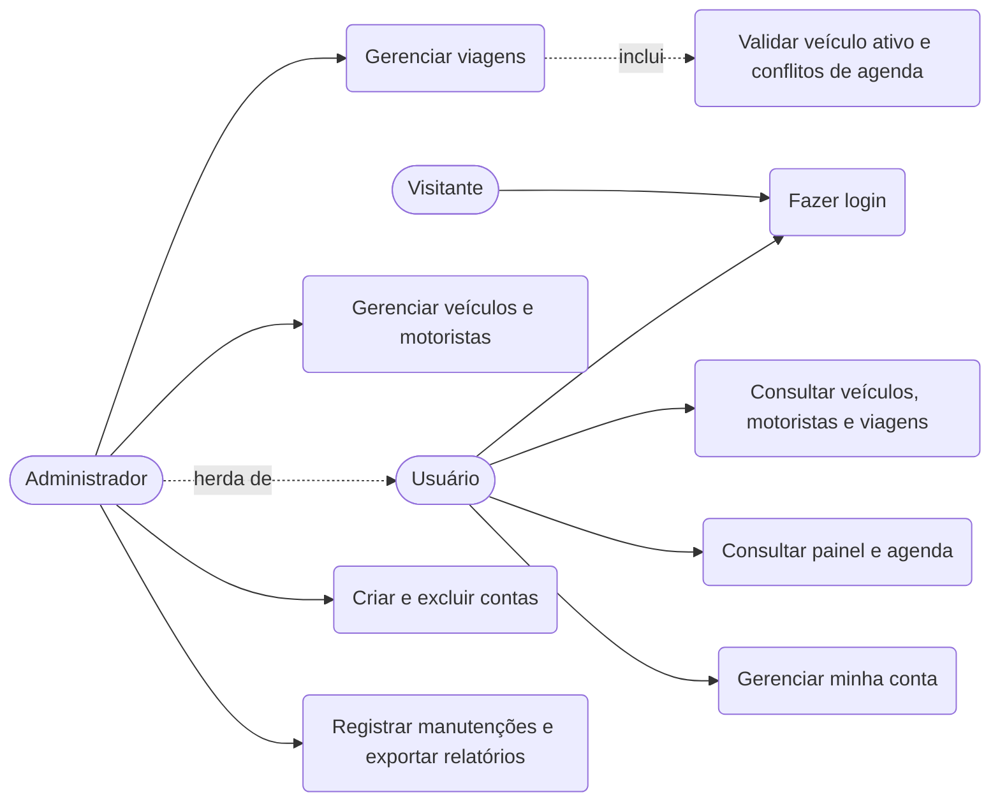
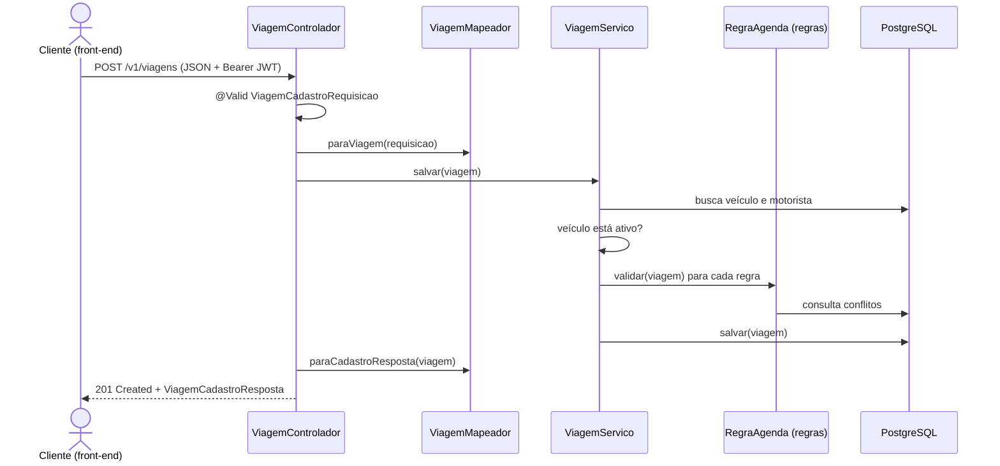
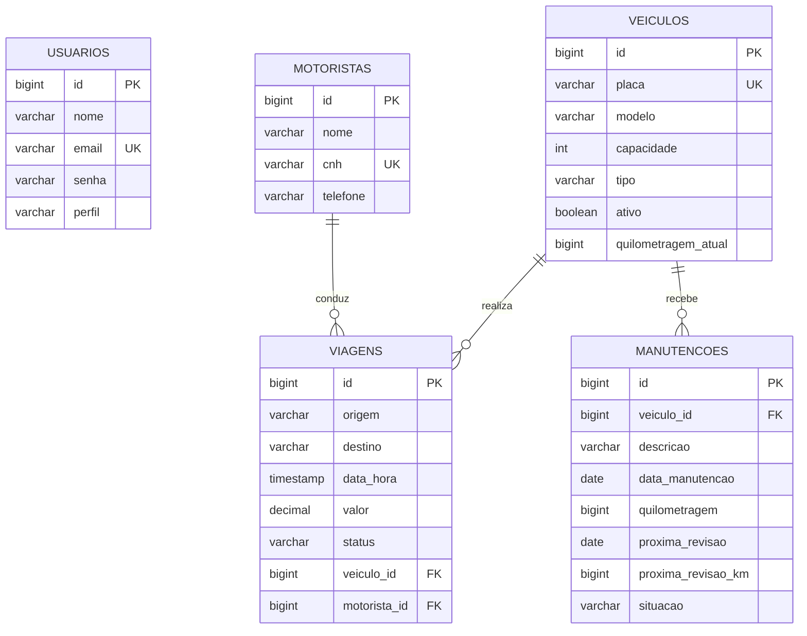
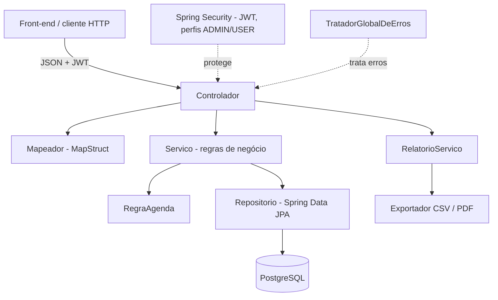
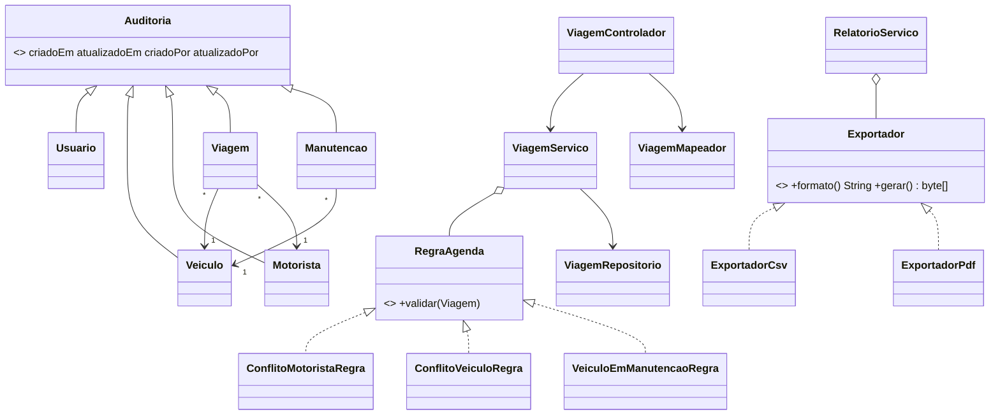

# Diagramas do Sistema de Transporte

> Os blocos abaixo são Mermaid. Cole em https://mermaid.live para exportar PNG/SVG para os slides.

## 1. Casos de uso

## 2. Sequência: agendar viagem

## 3. DER

## 4. Arquitetura em camadas

## 5. Classes: herança, interfaces e polimorfismo

